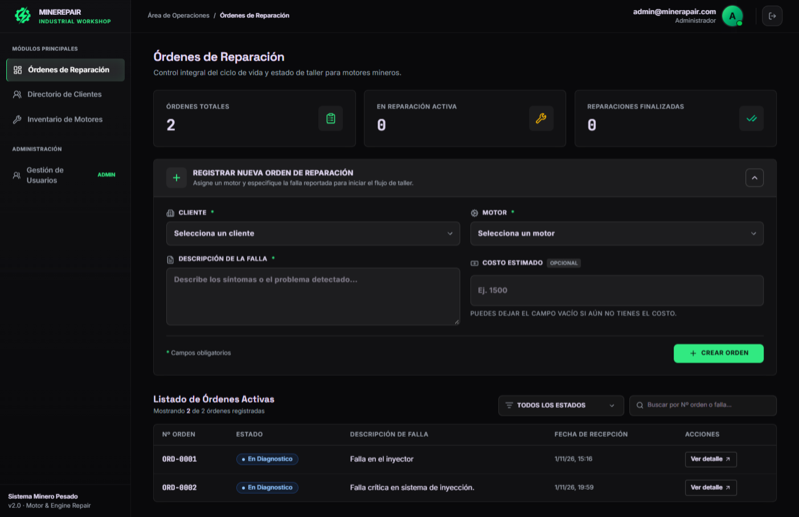
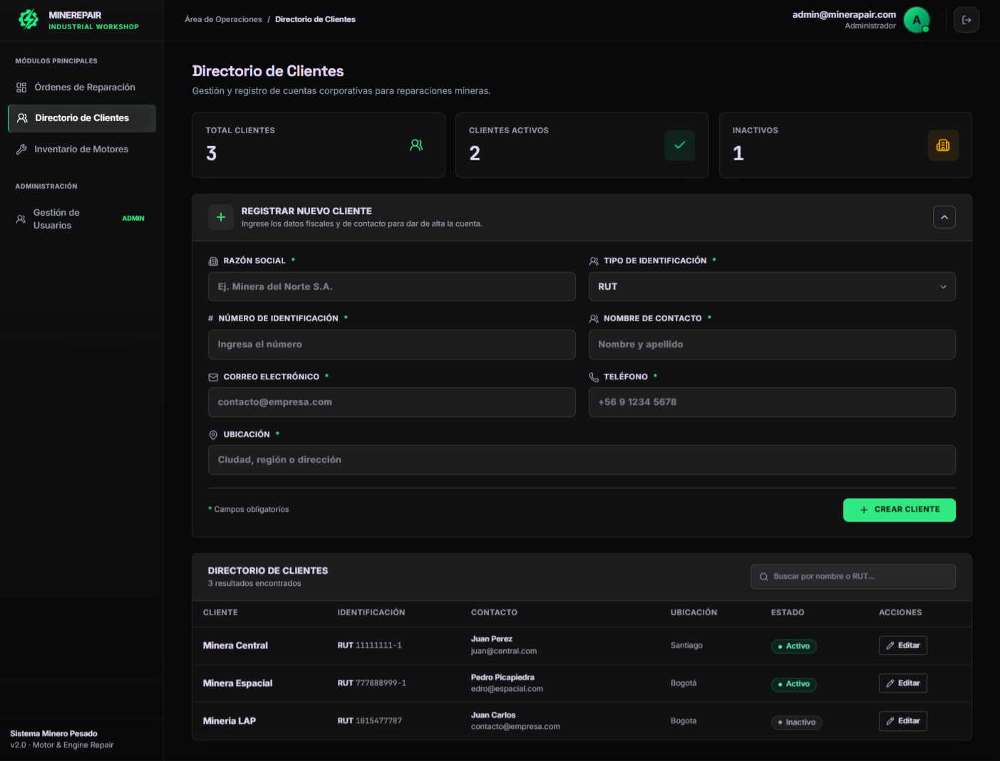
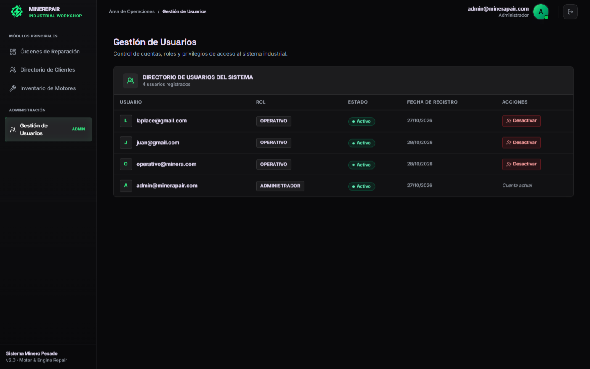
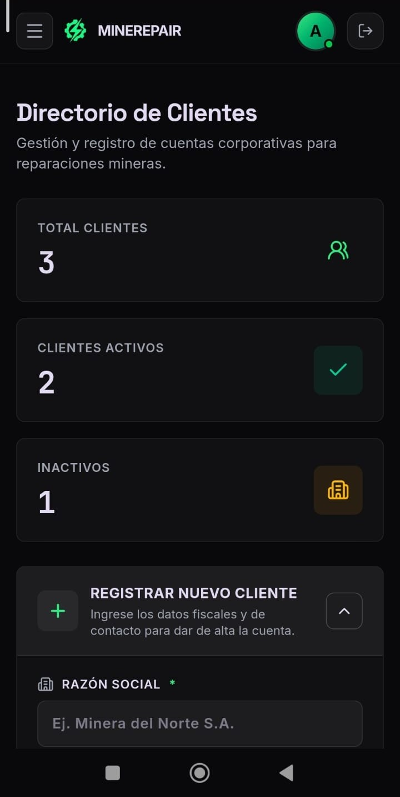
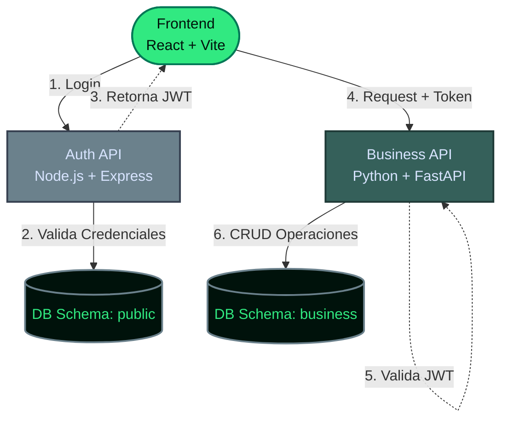

# MineRepair - Plataforma de Gestión de Reparaciones

[](https://nodejs.org/)
[](https://www.python.org/)
[](https://react.dev/)
[](https://www.postgresql.org/)
[](https://www.docker.com/)
[](https://github.com/features/actions)

MineRepair es un sistema de microservicios para gestionar reparaciones de motores de minería pesada. Centraliza el registro de clientes y motores, la creación y seguimiento de órdenes y el control de acceso según roles, desde una interfaz web adaptable.

## Capturas de Pantalla (Screenshots)

<table>
  <tr>
    <td width="50%"></td>
    <td width="50%"></td>
  </tr>
  <tr>
    <td width="50%"></td>
    <td width="50%"></td>
  </tr>
</table>

## 🔑 Credenciales de Demostración

> **⚠️ Nota para evaluadores:** La aplicación está desplegada con datos de prueba. Puedes usar las siguientes cuentas de demostración (creadas exclusivamente para este portafolio) para explorar los diferentes roles del sistema:

| Rol | Correo Electrónico | Contraseña |
| :--- | :--- | :--- |
| **Administrador** | `admin@minerarepair.com` | `password123` |
| **Operativo (Técnico)** | `tecnico@minerarepair.com` | `password123` |

*(El rol de Administrador permite gestionar usuarios, mientras que el Operativo tiene acceso restringido a la operación del taller).*

## Arquitectura

El frontend consume dos APIs independientes: Express se ocupa de autenticación y usuarios; FastAPI ofrece las operaciones del dominio de reparaciones. Ambos servicios se conectan a PostgreSQL alojado en Supabase.

<div align="center">



</div>

Los servicios se ejecutan como contenedores independientes y se comunican con la base de datos configurada mediante variables de entorno. La documentación interactiva de FastAPI está disponible en `/docs` cuando el servicio está levantado.

## Stack tecnológico

| Área              | Tecnologías                                                                               |
| ----------------- | ----------------------------------------------------------------------------------------- |
| Frontend          | React 19, TypeScript, Vite, Tailwind CSS, React Router, Axios                             |
| Autenticación     | Node.js 20, Express 5, TypeScript, Prisma, JWT, Zod                                       |
| Lógica de negocio | Python 3.12, FastAPI, Pydantic, SQLAlchemy                                                |
| Persistencia      | PostgreSQL en Supabase; Prisma para autenticación y SQLAlchemy para el dominio de negocio |
| DevOps            | Docker, Docker Compose, GitHub Actions                                                    |

## Características principales

- **Autenticación JWT y RBAC:** inicio de sesión con tokens JWT y autorización por roles de administrador y operativo.
- **Arquitectura por capas en FastAPI:** separación de rutas, servicios y repositorios para aislar las reglas de negocio del acceso a datos.
- **Ciclo de vida controlado:** las órdenes avanzan mediante transiciones permitidas entre estados, desde la recepción hasta la entrega.
- **Prevención de órdenes activas duplicadas:** no se permite crear otra orden para un motor que ya tiene una reparación en curso.
- **Protección contra envíos repetidos en la interfaz:** los formularios bloquean el botón mientras se procesa el envío y muestran el estado de guardado. Esta protección de UX complementa, pero no sustituye, las validaciones del backend.
- **Integración continua:** GitHub Actions verifica el build de TypeScript del servicio de autenticación, la sintaxis Python y el build de producción del frontend en pushes y pull requests a `main`.

## Decisiones y trade-offs de arquitectura

- **Aislamiento lógico de datos:** autenticación y negocio comparten la instancia PostgreSQL de Supabase, pero usan esquemas separados (`auth` y `business` en la configuración de ejemplo). Esto reduce la complejidad operativa inicial; si el sistema necesita aislamiento físico, cada servicio puede migrarse a una instancia independiente ajustando sus URLs de conexión.
- **Validación descentralizada de JWT:** el servicio de negocio valida los tokens emitidos por autenticación con HS256 y un secreto compartido. Es una solución simple para esta escala, pero implica distribuir el secreto y mantener validación en cada servicio. Al crecer el número de APIs, puede centralizarse la validación en un API Gateway (por ejemplo, Kong o Nginx) o migrarse a RS256 con llaves pública y privada.
- **Entrega continua:** el repositorio cuenta con integración continua y servicios contenedorizados, pero no configura despliegue automático a un entorno productivo. La etapa de CD puede incorporarse conectando el pipeline con el proveedor de despliegue elegido.

Para más contexto sobre estas decisiones, consulta [Decisiones de Arquitectura y Trade-offs](docs/arquitectura-decisiones.md).

## Security Roadmap & Trade-offs de Arquitectura

Actualmente, el token JWT se maneja en el frontend decodificándolo del `localStorage` para extraer los roles. Si bien el backend está protegido contra manipulación de roles (validación criptográfica), el almacenamiento en `localStorage` es vulnerable a ataques XSS (Cross-Site Scripting).

**Para un entorno de producción real, el plan de mejora a futuro es:**

1. **Almacenamiento en Cookies HttpOnly:** Migrar el JWT a cookies con las banderas `HttpOnly`, `Secure` y `SameSite=Strict`. Esto impide que scripts maliciosos (XSS) accedan al token.
2. **Centralización con API Gateway:** Implementar un API Gateway (ej. Nginx) para unificar los microservicios bajo un mismo dominio, facilitando el manejo de cookies y centralizando la validación del JWT.
3. **Refresco de Tokens (Refresh Tokens):** Implementar un sistema de Refresh Tokens para evitar que el usuario tenga que loguearse cada vez que expire el Access Token.

**Trade-off de Microservicios y Datos:**

- Se usó una sola instancia de PostgreSQL (Supabase) con dos esquemas lógicos (`public` y `business`) para garantizar el aislamiento de responsabilidades sin incurrir en latencia de red entre bases de datos.
- La validación del JWT es descentralizada (HS256) para mantener los servicios stateless y evitar un punto único de fallo (SPOF).

## Requisitos

- Git
- Docker Desktop o Docker Engine con Docker Compose
- Una base de datos PostgreSQL accesible (el ejemplo está preparado para Supabase)

La ejecución con Docker no requiere instalar Node.js ni Python en el host.

## Instalación y ejecución

1. Clona el repositorio y entra al directorio:

   ```bash
   git clone https://github.com/JorgeCb12/mining-engine-repair-platform.git
   cd mining-engine-repair-platform
   ```

2. Crea el archivo local de configuración a partir de la plantilla:

   ```bash
   cp .env.example .env
   ```

   En Windows PowerShell, usa:

   ```powershell
   Copy-Item .env.example .env
   ```

3. Edita `.env` y configura los datos reales de tu entorno. Como mínimo, revisa:
   - `DATABASE_URL`: conexión PostgreSQL usada por el servicio de autenticación.
   - `DIRECT_URL`: conexión directa usada por Prisma para tareas que no deben pasar por el pooler.
   - `BUSINESS_DATABASE_URL`: conexión PostgreSQL usada por FastAPI.
   - `JWT_SECRET`: secreto aleatorio compartido por los servicios que emiten y validan tokens.
   - `VITE_AUTH_API_URL` y `VITE_BUSINESS_API_URL`: URLs desde las que el navegador alcanza las APIs.

   Usa credenciales de una instancia de Supabase/PostgreSQL propia y mantén `.env` fuera del control de versiones. No publiques secretos en el repositorio.

4. Construye las imágenes y levanta los servicios en segundo plano:

   ```bash
   docker compose up -d --build
   ```

5. Comprueba los contenedores y consulta los servicios:

   ```bash
   docker compose ps
   ```

   - Frontend: [http://localhost:5173](http://localhost:5173)
   - Auth API: [http://localhost:3001](http://localhost:3001)
   - Business API: [http://localhost:8000](http://localhost:8000)
   - Swagger UI: [http://localhost:8000/docs](http://localhost:8000/docs)

Para seguir los logs, ejecuta `docker compose logs -f`. Para detener los servicios, ejecuta `docker compose down`.

## CI

El workflow de GitHub Actions se ejecuta en pushes y pull requests dirigidos a `main`. Comprueba el servicio de autenticación con Node.js 20, instala dependencias y compila TypeScript; instala las dependencias de negocio con Python 3.12 y compila los módulos para detectar errores de sintaxis; y finalmente construye el frontend con TypeScript y Vite.
